  <picture>
    <source media="(prefers-color-scheme: dark)" srcset="assets/hero-dark.svg">
    
  </picture>

  

    <a href="https://my-portfolio-hrdk2.vercel.app"><b>Portfolio</b></a> &nbsp;&middot;&nbsp;
    <a href="https://www.linkedin.com/in/hardik-gaonkar-b7706a376"><b>LinkedIn</b></a> &nbsp;&middot;&nbsp;
    <a href="mailto:hardikgaonkar2025@gmail.com"><b>Email</b></a> &nbsp;&middot;&nbsp;
    <a href="https://github.com/hrdk6/MyPortfolio/raw/HEAD/assets/Hardik_Gaonkar_Resume.pdf"><b>Résumé</b></a>
  

AI & ML undergraduate at **BMS Institute of Technology and Management, Bengaluru** (B.E., 2028). I build AI systems end to end and don't call one finished until a measurement says it works. Open to **AI/ML engineering internships**.

## Featured work

  <picture>
    <source media="(prefers-color-scheme: dark)" srcset="assets/machlume-dark.svg">
    
  </picture>

A native Windows app that reads live hardware telemetry with no admin rights or drivers: per-core CPU and clocks, package and iGPU power, thermal throttling, GPU engines and NPU load. It profiles local LLM runs in Ollama, benchmarks llama.cpp's 4-bit kernels ported to Rust, and predicts each run with a roofline model. The measurements showed that Llama 3 8B decode is memory-bound: 12.5 tok/s equals 54.5 GB/s, the bandwidth I measured. The source is private.

 

  <picture>
    <source media="(prefers-color-scheme: dark)" srcset="assets/careflow-dark.svg">
    
  </picture>

The LLM only sees records the signed-in user may access (RBAC plus row-level SQL filters), and a three-pass PII gateway masks patient identities before any cloud call. Risk models are trained on 99K patient encounters with patient-grouped splits, and chest X-ray triage is tested on 7.5K patient-disjoint films. Code: **[hrdk6/CareFlow-AI](https://github.com/hrdk6/CareFlow-AI)**.

## Toolbox

| | |
| :-- | :-- |
| **Languages** | Python · TypeScript · Rust · Go · JavaScript · SQL |
| **GenAI** | RAG · hybrid search · reranking · LLM agents · LLM evaluation · on-device inference (llama.cpp, Ollama, OpenVINO) |
| **ML** | scikit-learn · XGBoost · SHAP · ONNX Runtime · transfer learning |
| **Backend & apps** | FastAPI · PostgreSQL · pgvector · Next.js · Tauri 2 |
| **Infra** | Docker · Kubernetes · GitHub Actions |
